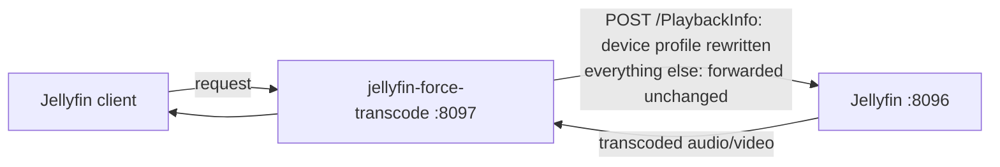

# jellyfin-force-transcode

[](https://github.com/Forward-Tonight7079/jellyfin-force-transcode/actions/workflows/docker.yml)
[](https://github.com/Forward-Tonight7079/jellyfin-force-transcode/releases)
[](https://github.com/Forward-Tonight7079/jellyfin-force-transcode/pkgs/container/jellyfin-force-transcode)
[](LICENSE)

jellyfin-force-transcode is a small reverse proxy. It makes your Jellyfin server **transcode audio,
video, or both**, for the clients that you select. Use it for the cases that Jellyfin cannot control
from the server. It is not a plugin. It does not change Jellyfin. It does not change your media files.

## Contents

- [Why this exists](#why-this-exists) · [Do you need this proxy?](#do-you-need-this-proxy)
- [What it solves](#what-it-solves-common-cases) · [How it works](#how-it-works) · [Compatibility](#compatibility)
- [Quick start](#quick-start) · [Configuration](#configuration-rulesjson) · [Logging](#logging)
- [Troubleshooting](#troubleshooting) · [License](#license)
- **[Matching guide](docs/README.md)**: how to select a device, an app, or a user, and real cases

## Why this exists

Jellyfin decides to **transcode** or to **direct-play** from the *client's* device profile. Jellyfin
trusts the client. When a client reports more than it can play, the server has few tools to correct it:

- **Audio channels.** In the past, Jellyfin ignored the setting "Maximum Allowed Audio Channels" for
  direct play ([jellyfin-web#5715](https://github.com/jellyfin/jellyfin-web/issues/5715)). Jellyfin
  10.9.11 corrected this. But the user must enable the setting, and the client must show it. Some
  clients (for example, the Android app with the ExoPlayer player) still tell the server that they
  support multichannel audio. Stereo devices then freeze or give no sound. The Jellyfin team closed a
  related issue as *not planned* ([jellyfin#11002](https://github.com/jellyfin/jellyfin/issues/11002)).
- **Transcoding for one device.** Jellyfin has no setting to always transcode for one client. You can
  only disable transcoding for a user, and then playback **fails**
  ([docs](https://jellyfin.org/docs/general/post-install/transcoding/)). Or you can set one global
  bitrate limit.
- **One codec or one format for one device.** Jellyfin cannot stop direct play of one codec for one
  client. For example, a TV can stutter on Opus audio. Jellyfin also cannot stop direct play of 10-bit
  video for one client. For example, a tablet can crash on 10-bit video.

This proxy changes only one request: the request where this negotiation occurs (`PlaybackInfo`). The
server then transcodes the audio, the video, or both, for the clients that you select.

> I made this tool because a kids' tablet froze on many movies with 7.1 audio. I did not want to
> re-encode all my files. See the [kids tablet case](docs/cases/kids-tablet.md).

### Do you need this proxy?

You may not need it. First, examine the built-in options:

- If your client shows a **"Maximum allowed audio channels"** setting, and it corrects your audio, use
  it. Jellyfin 10.9.11 and later apply it to direct play.
- If a **bitrate limit for each user** is sufficient, set it in Jellyfin.

Use this proxy when those options are not available or not sufficient. For example:

- The client has no such setting.
- You want the server to force the setting for all clients.
- You need different settings for each device or each user.
- You must force transcoding for one codec, a bit depth, a resolution, or a bitrate. Jellyfin has no
  setting for this for one device.

## What it solves (common cases)

Find your symptom in the table. Then use the field in the second column. The
[Configuration](#configuration-rulesjson) section describes each field.

| Symptom | Rule field | Real case |
|---|---|---|
| Multichannel audio (5.1, 7.1) freezes or gives no sound | `"audio": { "max_channels": 2 }` | [Kids tablet + 7.1](docs/cases/kids-tablet.md) |
| Stereo-only speakers | `"audio": { "max_channels": 2 }` | — |
| The audio stutters on one codec that the device reports as supported | `"audio": { "deny": ["opus"] }` | [LG TV + Opus](docs/cases/lg-opus.md) |
| The player crashes or stutters on 10-bit video | `"video": { "max_bit_depth": 8 }` | [Fire tablet + 10-bit HEVC](docs/cases/fire-10bit.md) |
| The device plays one video codec badly, at any bit depth | `"video": { "deny": ["hevc"] }` | — |
| An old device plays only a few codecs | `"video": { "allow": ["h264"] }`, `"audio": { "allow": ["aac"] }` | — |
| Playback buffers on a slow or remote link | `"max_bitrate": 6000000` | — |
| A small screen gets full-resolution video | `"video": { "max_width": 1280 }` | [Kids tablet + 7.1](docs/cases/kids-tablet.md) |

This works for any client, also for players that give you no setting for channels, codecs, bitrate,
or resolution. Did the proxy fix a different problem for you? Open an issue, so it can become a real
case here.

## How it works

**Stack:** one Docker container. It runs [mitmproxy](https://mitmproxy.org/) in reverse-proxy mode
with a small Python addon. There is nothing else.



- The proxy sends all requests to Jellyfin without changes, except `POST .../PlaybackInfo`.
- For that request, the proxy rewrites the client's `DeviceProfile`. It can set limits for audio
  channels, audio codecs, video codecs, video width, bit depth, and bitrate. It changes only the values that you
  set. Audio and video are independent.
- Jellyfin then reads the changed profile and **transcodes**.
- Video segments, WebSocket, and images pass through without changes.
- **Neutral and fail-safe:** with no rules, the proxy changes nothing. On any error, it sends the
  request through without changes. The proxy never stops playback.

## Compatibility

- Tested with **Jellyfin 12.1.0**.
- The proxy uses only the standard `POST /Items/{id}/PlaybackInfo` negotiation. Jellyfin has used it
  for many years. Thus we expect that the proxy also works with **Jellyfin 10.x and later**.
- If a later Jellyfin release changes the PlaybackInfo format, the proxy can stop to operate correctly.
  In that case, open an issue.

## Quick start

You need Docker. **The proxy changes nothing until you configure it.** You specify what to force in a
small `rules.json`.

Do these steps:

1. Create a `rules.json`. This example sets stereo, 1080p, and 8 Mbps for one client:

   ```json
   { "rules": [ { "name": "fire-tv",
                  "match": { "client": "Jellyfin Android TV" },
                  "audio": { "max_channels": 2 },
                  "video": { "max_width": 1920 },
                  "max_bitrate": 8000000 } ] }
   ```

   More examples (stereo for all clients, video only for one device, several rules) are in
   [Configuration](#configuration-rulesjson) below.

2. Start the container. Mount your file:

   ```bash
   docker run -d --name jellyfin-force-transcode \
     -p 8097:8080 \
     -e JELLYFIN_URL=http://192.168.1.50:8096 \
     -v "$(pwd)/rules.json:/addon/rules.json:ro" \
     --restart unless-stopped \
     ghcr.io/forward-tonight7079/jellyfin-force-transcode:latest
   ```

   Or use Docker Compose (Portainer or Dockge):

   ```yaml
   services:
     jellyfin-force-transcode:
       image: ghcr.io/forward-tonight7079/jellyfin-force-transcode:latest
       environment:
         JELLYFIN_URL: "http://192.168.1.50:8096"   # your Jellyfin address
       ports:
         - "8097:8080"
       volumes:
         - ./rules.json:/addon/rules.json:ro
       restart: unless-stopped
   ```

3. In the client, set the **server address** to `http://<docker-host-ip>:8097`.

### Verify it works

Run `docker logs -f jellyfin-force-transcode`. At startup, the proxy writes `loaded N rule(s)` and a
warning for each misspelled field. Then play a title on the client. The proxy writes one line with the
rule and with the decision of Jellyfin:

```
jft: playback device=unknown user='alex' client='Jellyfin Android TV' rule=fire-tv audio(max_channels=2) video(max_width=1920) max_bitrate=8000000 -> transcode: video -> h264, audio -> aac 2ch (AudioChannelsNotSupported)
```

If the line shows `rule=none`, the rule did not fit. Check the client name (see
[Match: select the playbacks](#match-select-the-playbacks)).

## Configuration (rules.json)

`rules.json` is the only place that defines the behavior. `JELLYFIN_URL` (an environment variable) is
only the address of your Jellyfin. This example has several rules:

```json
{
  "devices": {
    "kids-tablet":    ["192.168.1.40", "10.1.0.3"],
    "living-room-tv": ["192.168.1.50"]
  },
  "rules": [
    { "name": "kids-tablet",
      "match": { "device": "kids-tablet" },
      "audio": { "max_channels": 2 },
      "video": { "max_width": 1280 },
      "max_bitrate": 6000000 },

    { "name": "tv-no-opus",
      "match": { "device": "living-room-tv" },
      "audio": { "deny": ["opus"] } },

    { "name": "kids-account",
      "match": { "user": ["Reggie", "Sid"] },
      "audio": { "max_channels": 2 } },

    { "name": "everything-else",
      "match": {},
      "audio": { "max_channels": 2 } }
  ]
}
```

**Fields.** A rule has two optional groups, `audio` and `video`, and one top-level field,
`max_bitrate`. Set only the fields that you need. Audio and video are independent: an audio-only rule
copies the video, and a video-only rule copies the audio.

| Field | Effect |
|---|---|
| `audio.deny` | Audio codecs that the server must always transcode (for example, `["opus"]`). The client does not direct-play them, and the server does not copy them in a remux. |
| `audio.allow` | The only audio codecs that the client may direct-play (for example, `["aac", "mp3"]`). The server transcodes all other audio codecs. |
| `audio.transcode_to` | Optional. The audio codec that the server sends when it transcodes (for example, `"aac"` or `"eac3"`). If you omit it, the server selects a codec from the client's list, but not a `deny` codec. |
| `audio.max_channels` | Downmix target. `2` = stereo. The server transcodes audio with more channels. |
| `video.deny` | Video codecs that the server must always transcode (for example, `["av1"]`). |
| `video.allow` | The only video codecs that the client may direct-play (for example, `["h264"]`). |
| `video.max_bit_depth` | Limit for the video bit depth (for example, `8`). The server transcodes video with a higher bit depth, such as 10-bit HEVC. 8-bit video still direct-plays. |
| `video.max_width` | Limit for the width, in pixels (for example, `1280` = 720p). The server downscales video that is wider. |
| `max_bitrate` | Limit for the total stream bitrate, in bits per second (for example, `6000000`). The server transcodes the video when the source is higher. |

**`deny` or `allow`?** Use `deny` when one codec is bad on a device ("Opus stutters"). It is short, and
it changes nothing else. Use `allow` when a device can play only a few codecs ("only AAC"). If you set
both, the client may direct-play the `allow` codecs minus the `deny` codecs.

Write a codec list as a JSON array (`["aac", "mp3"]`) or as a comma string (`"aac,mp3"`). Both work.

A rule with none of these fields does nothing. A misspelled field also does nothing, but the proxy
writes a warning about it in the log (see [Logging](#logging)).

### Match: select the playbacks

`match` selects the playbacks for a rule. The proxy applies the **first** rule whose `match` fits.
Each key in `match` must fit (AND). A list of values fits when one value fits (OR). An empty
`match: {}` fits each playback.

| Key | Selects | Example |
|---|---|---|
| `device` | one device from the `devices` section (by IP address) | `"device": "living-room-tv"` |
| `ip` | an IP address or a network | `"ip": "10.1.0.0/24"` |
| `user` / `user_id` | one person | `"user": "Reggie"` |
| `client` | one type of app | `"client": "Jellyfin for Android"` |
| `device_id` | one installation of an app | `"device_id": "/^0bf2cfd8/"` |
| `user_agent` | the app and its version | `"user_agent": "/okhttp/i"` |

A value is a plain string (equal) or a `/regex/`. The log line `PlaybackInfo from …` shows the values
of each client. The proxy reads `rules.json` again when you save it.

**Which key to use?** Read the [Matching guide](docs/README.md). For one device, use
`device`, because the values that the apps send change for different reasons. For one person, use
`user`.

### Upgrade from 0.x

Version 1.0 moved the fields into the `audio` and `video` groups. **The old fields still work.** The
proxy writes one warning for each old field, with the new name. Change your `rules.json` when you can:

| 0.x field | 1.x field |
|---|---|
| `max_audio_channels` | `audio.max_channels` |
| `keep_audio_codecs` | `audio.allow` |
| `transcode_audio_codec` | `audio.transcode_to` |
| `keep_video_codecs` | `video.allow` |
| `max_video_bit_depth` | `video.max_bit_depth` |
| `max_width` | `video.max_width` |
| `max_bitrate` | `max_bitrate` (no change) |

One difference: the old `max_audio_channels` field also allowed direct play only for AAC and MP3. The
old field keeps this behavior. The new `audio.max_channels` field sets a limit only for the channels.
To get the old result, add `"allow": ["aac", "mp3"]`.

## Logging

The container writes its logs to stdout. Read them with `docker logs -f jellyfin-force-transcode`. The
`LOG` environment variable sets how much the proxy writes:

| `LOG` | Output |
|---|---|
| `events` (default) | Only the important lines: startup, rules file changes, each new `PlaybackInfo from …` identity, one `playback …` line for each playback, and warnings. It stays quiet on a busy server. |
| `full` | Everything that mitmproxy sees — one line for each request (this includes video segments). Use it to debug. |
| `quiet` | Silent (errors only). |

In `events` mode the log looks like this:

```
jft: loaded 2 rule(s), 1 device(s) from /addon/rules.json: kids-tablet, everything-else
jft: rule=kids-tablet: unknown field audio.denny (ignored)
jft: PlaybackInfo from device=kids-tablet ip=192.168.1.40 user='Reggie' user_id='60074fe7…' client='Jellyfin for Android' device_id='0bf2…' user_agent='…'
jft: playback device=kids-tablet user='Reggie' client='Jellyfin for Android' rule=kids-tablet audio(max_channels=2) video(max_width=1280) max_bitrate=6000000 -> transcode: video -> h264, audio -> aac 2ch (AudioChannelsNotSupported, ContainerBitrateExceedsLimit)
jft: playback device=unknown user='alex' client='Jellyfin Web' rule=none -> direct play
jft: rules file error in /addon/rules.json: Illegal trailing comma before end of array: line 4 column 1 (char 222); keeping the previous 2 rule(s)
```

- **`loaded N rule(s)`**: the proxy writes this line at startup and each time that you save
  `rules.json`. The proxy examines the file every 2 seconds, so you see a change at once. You do not
  need to restart.
- **`rules file error`**: the proxy writes this line one time for each bad save. The line gives the line
  number and the column. The proxy keeps the previous good rules until you correct the file.
- **`rule=… deprecated field`** or **`unknown field`**: the proxy writes this warning one time for each
  rule. A deprecated field still works. An unknown field (for example, a typing error) does nothing.
- **`PlaybackInfo from …`**: the proxy writes this line one time for each new identity (client,
  installation, user, and IP address). It shows the
  exact values that the proxy parsed. **Copy these values into a rule `match`.** They can be different
  from the Jellyfin dashboard, so this line is the best source.
- **`playback …`**: the proxy writes this line for each playback. It shows the device, the user, the
  app, the rule (or `rule=none`),
  the fields that the rule applied, and the decision of Jellyfin. The decision is `direct play`,
  `remux`, or `transcode` with the reasons. For `transcode`, the line shows each stream: `video copied`
  or `video -> h264`, and `audio copied` or `audio -> aac 2ch`.

The proxy writes only the rule name, the parsed identity, the fields that it applied, and the decision
of Jellyfin. It never writes tokens, credentials, or media content. Docker rotates the logs (with the standard `json-file` driver),
so they do not grow without a limit.

## Troubleshooting

**The client direct-plays. Nothing transcodes.** Find the `playback …` line for that client. If it
shows `rule=none`, the rule did not fit. The `PlaybackInfo from …` line shows the exact `client` and
`device_id` that the proxy parsed. Copy those values into your `match`. A plain `client` value must be
equal to the parsed value. Or use a `/regex/`. If there is no `playback …` line, the client does not use
the proxy (see below).

**The rule fits, but nothing changes.** Look for an `unknown field` warning in the log. A misspelled
field (for example, `audio.denny`) does nothing.

**The audio is still multichannel.** Make sure that the rule that fits sets `audio.max_channels`. A
video-only rule keeps the audio. Also confirm that the traffic goes through the proxy. The client's
server address must be `http://<host>:8097`, not Jellyfin directly.

**The app cannot connect.** Confirm that the container runs. Confirm that `JELLYFIN_URL` points to a
reachable Jellyfin (`http://IP:8096`). For HTTPS or remote access, make sure that your outer reverse
proxy forwards WebSockets.

**How do I confirm that it works?** Play a title and read the `playback …` line in the proxy log. It
shows the decision of Jellyfin for that playback. **Dashboard → Playback** (active streams) in Jellyfin
shows the same decision.

**Playback stopped after a Jellyfin upgrade.** The PlaybackInfo format may have changed. Set
`LOG=full`. Capture a `POST .../PlaybackInfo`. Then open an issue.

## Notes and caveats

- The proxy is now between the client and Jellyfin. It uses `restart: unless-stopped`. If the proxy
  stops, set the server address in the client to the Jellyfin address.
- The proxy does not keep credentials and does not write them to the log. It changes only the
  `PlaybackInfo` body, and it sends all other data without changes.
- Do not connect the plain HTTP port to the internet. For remote access, put the proxy behind your own
  TLS reverse proxy with WebSocket support. Then set the server address in the client to that hostname.
- After a Jellyfin upgrade, confirm that the proxy still forces transcoding. If the PlaybackInfo
  format changed, open an issue.
- The proxy does not change your media files.

## Why not a Jellyfin plugin?

A Jellyfin plugin cannot change the PlaybackInfo negotiation for app clients. The server makes that
decision from the client's device profile, and it trusts the client. A proxy is the only place to
change the profile without a change to Jellyfin.

## License

MIT. See [LICENSE](LICENSE).
